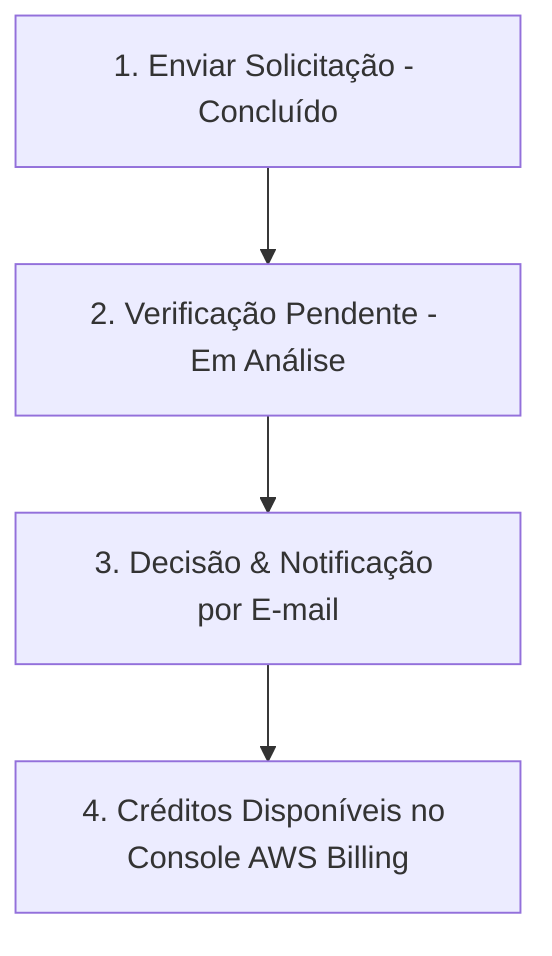

# 🚀 AWS Startups & AWS Activate — Acompanhamento e Ativação

Documento de registro e acompanhamento da solicitação de créditos do programa **AWS Activate Founders / Startups** para o projeto **Multi+ (NexusLocal)**.

---

## 📌 Status Atual da Solicitação

| Campo | Detalhe |
| :--- | :--- |
| **Data da Solicitação** | 11/10/2026 |
| **Créditos Solicitados** | **US$ 1.000** |
| **ID da Conta AWS** | `184617397471` |
| **E-mail / Builder ID** | `henz****@gmail.com` (Vinculação 🟢 **Concluída**) |
| **Status da Inscrição** | 🟡 **Pendente** (Etapa 2 de 3: *Verificação pendente*) |
| **Próxima Etapa** | Decisão sobre os créditos do AWS Activate (Aprovação por e-mail) |
| **Link de Monitoramento** | [Painel de Status AWS Startups](https://startups.aws.com/pt-br/credits/status) |

---

## 🧭 Fluxo de Aprovação



O prazo padrão de análise da AWS costuma variar entre **3 a 7 dias úteis**. A confirmação oficial é enviada no e-mail cadastrado na conta AWS.

---

## 🔌 Integração & Plugin para Claude Code

Assim que os créditos ou a conta estiverem confirmados, você pode instalar o plugin oficial do assistente de startups no Claude Code:

```bash
claude plugin install aws-startup-advisor@claude-plugins-official
```

### O que o plugin oferece:
- Dicas de arquitetura para maximizar a economia dos créditos AWS.
- Recomendações de serviços para hospedagem de IA e infraestrutura cloud.
- Melhores práticas de segurança e governança de custos na AWS.

---

## 💡 Oportunidades de Uso dos Créditos no Multi+ / NexusLocal

Quando aprovados os **US$ 1.000**, os créditos podem ser aplicados em:

1. **Amazon Bedrock (Modelos de IA na Nuvem):**
   - Acesso nativo a modelos Anthropic Claude (Opus, Sonnet, Haiku), Llama 3, Mistral e Titan diretamente via API da AWS sem custos adicionais de cartão de crédito.
2. **Servidores de Inferência e GPU (Amazon EC2):**
   - Instâncias com aceleradores (G4dn / G5) para rodar modelos locais como Ollama, vLLM e Flux Image Generation com alto throughput.
3. **Armazenamento e Backup (Amazon S3):**
   - Snapshots automáticos de banco de dados (`nexuslocal.db`) e armazenamento persistente de imagens geradas e anexos.
4. **Hospedagem de Produção:**
   - Deploy escalável do backend e frontend em containers (ECS / Fargate ou Lightsail).

---

## 🔗 Links Úteis

- **Acompanhar Status:** [https://startups.aws.com/pt-br/credits/status](https://startups.aws.com/pt-br/credits/status)
- **Gerenciamento de Custos & Faturamento:** [AWS Billing Console](https://console.aws.amazon.com/billing/)
- **Programa AWS Activate:** [Página Inicial AWS Startups](https://startups.aws.com/pt-br/)
