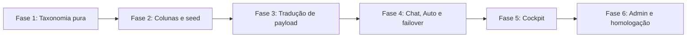

# 04 — Roadmap e subtarefas

**Multi+ / NexusLocal** · Checklist de execução

Nenhuma fase começa sem aval. Checkboxes abaixo estão abertos de propósito: isto ainda não foi implementado.

---

## Fase 1 — Taxonomia pura, sem banco e sem UI

*Objetivo: classificar um nome de modelo sem tocar no `nexuslocal.db` e sem mudar o payload real.*

- [x] **1.1** Criar `backend/reasoning/families.py` com `ReasoningControl`, níveis internos e a tabela de famílias do doc 01.
- [x] **1.2** Função pura `resolve_family(provider_id, model_name) -> ControlSpec`. Sem match → `none`.
- [x] **1.3** Cada linha da tabela leva um comentário com a fonte a confirmar (doc do provedor + data da checagem). Não marcar nível que a doc não liste.
- [x] **1.4** Testes em `backend/tests/test_reasoning_effort.py`: R1 → `always_on`; Llama/Groq genérico → `none`; um id Gemini thinking → `gemini_thinking`; string vazia → `none`.
- [x] **1.5** Testes só com funções puras. Zero conexão com `backend/nexuslocal.db`.

**Aceite:** importar o módulo não altera request nenhum. Suíte nova verde em banco nenhum.

---

## Fase 2 — Colunas e seed

*Objetivo: o catálogo passa a dizer se o modelo tem dial, sem o chat usar isso ainda.*

- [x] **2.1** Em `init_db()` (`backend/database.py`), `ALTER TABLE` de `reasoning_control`, `reasoning_levels`, `reasoning_default`, `reasoning_control_source`, cada um em `try/except (aiosqlite.OperationalError, sqlite3.OperationalError)`, no padrão de `supports_vision`.
- [x] **2.2** Não criar índice dessas colunas dentro do `CREATE TABLE` legado do `SCHEMA`.
- [x] **2.3** Seed idempotente: só preenche `unset` ou nulo. Não sobrescreve `admin`. Novos modelos inseridos por `sync_provider_models` entram com `unset`.
- [x] **2.4** `GET /admin/models` (`list_all_models` em `admin.py`) projeta os quatro campos, aplicando `json.loads` em `reasoning_levels` para entregar `string[] | null`. `frontend/src/types.ts` (`Model`) declara os mesmos campos.
- [x] **2.5** Teste de migração e de "admin não é reescrito" em cópia temporária ou `:memory:`. Proibido usar o banco vivo.

**Aceite:** um modelo desconhecido fica `none`. Um override `admin` sobrevive a uma segunda rodada de seed.

---

## Fase 3 — Tradução de payload

*Objetivo: o provedor só recebe campo de esforço quando o contrato daquele modelo existe.*

- [x] **3.1** Função pura `build_effort_payload(control, level, base_payload)`.
- [x] **3.2** `none`, `always_on` e nível fora de `reasoning_levels` devolvem o payload idêntico ao de hoje.
- [x] **3.3** `BaseProvider.stream_chat` e `OpenAICompatProvider.stream_chat` ganham argumentos opcionais `reasoning_effort: Optional[str] = None` e `reasoning_control: Optional[str] = None`, chamando o builder.
- [x] **3.4** `GeminiProvider.stream_chat` recebe `reasoning_effort` e escreve `thinkingConfig` em `generationConfig` no fluxo nativo e em cachedContent. Não manda `reasoning_effort` nesse caminho.
- [x] **3.5** `CloudflareProvider` ignora o argumento.
- [x] **3.6** Rede de segurança em `stream_from_llm` (`resolve_request.py`): se a resposta for HTTP 400 citando termos de esforço/reasoning, emite `effort_dropped` (`provider_rejected`) e realiza **uma única** retentativa sem o campo, antes que o erro atinja `check_and_deactivate_model`.
- [x] **3.7** Testes do builder sem rede: payload `none` igual ao dict de entrada; Gemini não ganha chave OpenAI; OpenRouter ganha objeto `reasoning`; nível inválido é omitido.

**Aceite:** diff do JSON de um modelo `none` é vazio em relação ao comportamento atual.

---

## Fase 4 — Fio do chat, Auto e failover

*Objetivo: a preferência viaja no WebSocket e morre se o modelo que vai atender não aceita.*

- [x] **4.1** `backend/routers/chat.py` lê `reasoning_effort` opcional do WebSocket e repassa a `resolve_and_stream`. Ausente = comportamento atual.
- [x] **4.2** `resolve_and_stream` repassa a `stream_from_llm`, que busca o controle do modelo ativo no banco.
- [x] **4.3** Depois do failover, reavaliar o controle do modelo reserva. Se não servir, omitir e emitir `effort_dropped` com reason `failover`.
- [x] **4.4** Modo Auto: não deixar o esforço escolher o modelo. Aplicar a preferência só se o escolhido tiver o nível. Senão omitir e avisar `unsupported_model`.
- [x] **4.5** Fusion, enhancer, extrator de memória e dream não recebem o campo na v1. Teste que o orquestrador do Fusion não ganhou o kwarg.
- [x] **4.6** Testes do resolvedor com provider falso. Sem HTTP real. Sem banco vivo.

**Aceite:** modelo sem dial não vê campo novo. Reserva sem dial não herda o campo do modelo original.

---

## Fase 5 — Cockpit e Interface (Fidelidade visual às imagens de referência)

*Objetivo: o seletor existe só para quem tem dial, no balão que já está no rodapé da caixa de mensagem, exatamente como referenciado em `selecao-esforco.jpg` e `tela-inicial-digitacao-select-model.png`.*

- [x] **5.1** Atualizar o pill disparador (`.model-trigger`) em `ModelSelector.tsx`: quando o modelo tiver controle de esforço ativo, renderizar o nome do modelo e o badge do nível de esforço lado a lado (ex.: `Sonnet 5.5 Alto`, ou `Claude 3.7 Sonnet Médio`), sincronizado tanto no botão interno do composer (`composer-actions-right`) quanto no rodapé externo (`input-footer-row`), conforme `tela-inicial-digitacao-select-model.png`.
- [x] **5.2** Linha "Esforço" como `cockpit-nav-row` em `ModelSelector.tsx`: posicionada no menu principal logo abaixo dos modelos rápidos (`topModels`) e imediatamente antes de `Mais modelos >`. Omitir a linha quando `none`.
- [x] **5.3** `always_on`: frase fixa informativa, sem flyout/seta.
- [x] **5.4** Submenu Flyout lateral (`cockpit-submenu-flyout` no Desktop / BottomSheet drill-down no Mobile), conforme `selecao-esforco.jpg`:
  - Cabeçalho explicativo sutil no topo do flyout: *"Mais esforço significa respostas mais completas, mas leva mais tempo e consome seus limites mais rápido."* (`chat.effortExplainerHint`).
  - Lista de opções baseada em `reasoning_levels` do modelo ativo:
    - Item ativo com checkmark azul (`✓`) alinhado à direita.
    - Nível default/recomendado com tag sutil `Recomendado` (`chat.effortRecommended`).
    - Nível de alta intensidade (`max` ou `extra`) com badge/alerta `⚠️ 5x ou mais de uso` (`chat.effortMaxWarning`).
- [x] **5.5** Persistir a escolha por `model_id` usando `_scopedKey('reasoning_effort_by_model')` e `_scopedKey('reasoning_effort_auto')` no padrão de `useStore.ts`.
- [x] **5.6** `sendMessage` em `useChat.ts` inclui `reasoning_effort` no payload do WebSocket só quando houver dial e nível escolhido.
- [x] **5.7** `useChat.ts` trata evento `effort_dropped` no switch do WebSocket e exibe toast explicativo traduzido.
- [x] **5.8** CSS puro com tokens existentes em `index.css`. Claro e escuro. Sem Tailwind.
- [x] **5.9** Strings completas em `pt-BR.json`, `en-US.json`, `es-ES.json`.

**Aceite:** visual idêntico ao padrão de design de `selecao-esforco.jpg` e `tela-inicial-digitacao-select-model.png`; modelo `none` não mostra a linha; modelo com três níveis não mostra Máx; trocar de modelo não vaza o nível do anterior para um contrato incompatível.

---

## Fase 6 — Admin e homologação

*Objetivo: corrigir família errada sem deploy de código, e provar que o chat antigo não regrediu.*

- [x] **6.1** Atualizar `ModelUpdate` em `backend/models.py` e `PATCH /admin/models/{model_id}` em `backend/routers/admin.py` para permitir gravar controle, níveis e default com `reasoning_control_source = 'admin'`.
- [x] **6.2** Seed seguinte não apaga esse override. Teste em banco temporário.
- [x] **6.3** `npm run build` no `frontend` com 0 erros de tipo.
- [x] **6.4** `pytest` da suíte nova apenas. Se a suíte antiga for rodada, o banco tem de ser cópia ou `:memory:`, nunca `backend/nexuslocal.db`.
- [x] **6.5** Matriz manual, anotada neste arquivo quando for executada:
  - modelo `none` (Llama/Groq): request sem campo novo, chat responde;
  - modelo com dial: nível Médio chega no campo certo daquele provedor;
  - nível inválido forçado no WS: omitido, chat não cai;
  - failover para modelo `none`: `effort_dropped`, resposta segue;
  - Auto + preferência Alta + modelo roteado sem dial: sem 400;
  - Fusion ligado: esforço ignorado, painel não quebra.
- [x] **6.6** Não reindexar GitNexus. Deploy só se for pedido, pelo pipeline do `AGENTS.md` (integridade, backup, `docker compose`, health no container — porta 8000 do host é Portainer).

**Aceite:** admin corrige um falso positivo de família e o cockpit acompanha no próximo `getModels()`, sem heurística furar o override.

---

## Fora deste checklist

- Repasse de esforço para membros do Fusion.
- Extended thinking com `budget_tokens` numérico livre.
- Esforço influenciando o score do Smart Router.
- Slider global "para todos os modelos".
