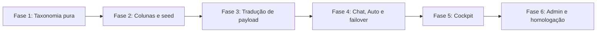

# 04 — Roadmap e subtarefas

**Multi+ / NexusLocal** · Checklist de execução

Nenhuma fase começa sem aval. Checkboxes abaixo estão abertos de propósito: isto ainda não foi implementado.

---

## Fase 1 — Taxonomia pura, sem banco e sem UI

*Objetivo: classificar um nome de modelo sem tocar no `nexuslocal.db` e sem mudar o payload real.*

- [ ] **1.1** Criar `backend/reasoning/families.py` com `ReasoningControl`, níveis internos e a tabela de famílias do doc 01.
- [ ] **1.2** Função pura `resolve_family(provider_id, model_name) -> ControlSpec`. Sem match → `none`.
- [ ] **1.3** Cada linha da tabela leva um comentário com a fonte a confirmar (doc do provedor + data da checagem). Não marcar nível que a doc não liste.
- [ ] **1.4** Testes em `backend/tests/test_reasoning_effort.py`: R1 → `always_on`; Llama/Groq genérico → `none`; um id Gemini thinking → `gemini_thinking`; string vazia → `none`.
- [ ] **1.5** Testes só com funções puras. Zero conexão com `backend/nexuslocal.db`.

**Aceite:** importar o módulo não altera request nenhum. Suíte nova verde em banco nenhum.

---

## Fase 2 — Colunas e seed

*Objetivo: o catálogo passa a dizer se o modelo tem dial, sem o chat usar isso ainda.*

- [ ] **2.1** Em `init_db()` (`backend/database.py`), `ALTER TABLE` de `reasoning_control`, `reasoning_levels`, `reasoning_default`, `reasoning_control_source`, cada um em `try/except sqlite3.OperationalError`, no padrão de `supports_vision`.
- [ ] **2.2** Não criar índice dessas colunas dentro do `CREATE TABLE` legado.
- [ ] **2.3** Seed idempotente: só preenche `unset`. Não sobrescreve `admin`.
- [ ] **2.4** `GET /admin/models` devolve os quatro campos. `frontend/src/types.ts` (`Model`) declara os mesmos.
- [ ] **2.5** Teste de migração e de "admin não é reescrito" em cópia temporária ou `:memory:`. Proibido usar o banco vivo.

**Aceite:** um modelo desconhecido fica `none`. Um override `admin` sobrevive a uma segunda rodada de seed.

---

## Fase 3 — Tradução de payload

*Objetivo: o provedor só recebe campo de esforço quando o contrato daquele modelo existe.*

- [ ] **3.1** Função pura `build_effort_payload(control, level, base_payload)`.
- [ ] **3.2** `none`, `always_on` e nível fora de `reasoning_levels` devolvem o payload idêntico ao de hoje.
- [ ] **3.3** `OpenAICompatProvider.stream_chat` ganha argumento opcional e só então chama o builder. Default atual permanece.
- [ ] **3.4** `GeminiProvider` escreve `thinkingConfig` no caminho nativo. Não manda `reasoning_effort` nesse caminho.
- [ ] **3.5** `CloudflareProvider` ignora o argumento.
- [ ] **3.6** Retentativa única se HTTP 400 citar o campo de esforço. Uma vez. Depois segue sem o campo.
- [ ] **3.7** Testes do builder sem rede: payload `none` igual ao dict de entrada; Gemini não ganha chave OpenAI; nível inválido é omitido.

**Aceite:** diff do JSON de um modelo `none` é vazio em relação ao comportamento atual.

---

## Fase 4 — Fio do chat, Auto e failover

*Objetivo: a preferência viaja no WebSocket e morre se o modelo que vai atender não aceita.*

- [ ] **4.1** `backend/routers/chat.py` lê `reasoning_effort` opcional. Ausente = comportamento atual.
- [ ] **4.2** `resolve_request.py` repassa ao `stream_chat` do modelo que realmente vai atender.
- [ ] **4.3** Depois do failover, reavaliar o controle do reserva. Se não servir, omitir e emitir `effort_dropped` com reason `failover`.
- [ ] **4.4** Modo Auto: não deixar o esforço escolher o modelo. Aplicar a preferência só se o escolhido tiver o nível. Senão omitir e avisar.
- [ ] **4.5** Fusion, enhancer, extrator de memória e dream não recebem o campo na v1. Teste que o orquestrador do Fusion não ganhou o kwarg.
- [ ] **4.6** Testes do resolvedor com provider falso. Sem HTTP real. Sem banco vivo.

**Aceite:** modelo sem dial não vê campo novo. Reserva sem dial não herda o campo do modelo original.

---

## Fase 5 — Cockpit

*Objetivo: o seletor existe só para quem tem dial, no balão que já está no rodapé.*

- [ ] **5.1** Linha "Esforço" em `ModelSelector.tsx`, conforme o doc 03. Some quando `none`.
- [ ] **5.2** `always_on`: frase fixa, sem flyout.
- [ ] **5.3** Flyout lista só `reasoning_levels`. Default da família marcado "Recomendado".
- [ ] **5.4** Desktop: flyout lateral. Abaixo de 768px: `BottomSheet`. `Escape` fecha.
- [ ] **5.5** Persistir a escolha por `model_id` no `localStorage`, no padrão de `useStore.ts`.
- [ ] **5.6** Incluir `reasoning_effort` no payload do WebSocket só quando houver dial e nível.
- [ ] **5.7** Toast em `effort_dropped`.
- [ ] **5.8** CSS com tokens existentes em `index.css`. Claro e escuro. Sem Tailwind.
- [ ] **5.9** Strings em `pt-BR.json`, `en-US.json`, `es-ES.json`.

**Aceite:** modelo `none` não mostra a linha. Modelo com três níveis não mostra Máx. Trocar de modelo não vaza o nível do anterior para um contrato incompatível.

---

## Fase 6 — Admin e homologação

*Objetivo: corrigir família errada sem deploy de código, e provar que o chat antigo não regrediu.*

- [ ] **6.1** No painel admin de modelo, permitir gravar controle, níveis e default. Gravar `reasoning_control_source = admin`.
- [ ] **6.2** Seed seguinte não apaga esse override. Teste em banco temporário.
- [ ] **6.3** `npm run build` no `frontend` com 0 erros de tipo.
- [ ] **6.4** `pytest` da suíte nova apenas. Se a suíte antiga for rodada, o banco tem de ser cópia ou `:memory:`, nunca `backend/nexuslocal.db`.
- [ ] **6.5** Matriz manual, anotada neste arquivo quando for executada:
  - modelo `none` (Llama/Groq): request sem campo novo, chat responde;
  - modelo com dial: nível Médio chega no campo certo daquele provedor;
  - nível inválido forçado no WS: omitido, chat não cai;
  - failover para modelo `none`: `effort_dropped`, resposta segue;
  - Auto + preferência Alta + modelo roteado sem dial: sem 400;
  - Fusion ligado: esforço ignorado, painel não quebra.
- [ ] **6.6** Não reindexar GitNexus. Deploy só se for pedido, pelo pipeline do `AGENTS.md` (integridade, backup, `docker compose`, health no container — porta 8000 do host é Portainer).

**Aceite:** admin corrige um falso positivo de família e o cockpit acompanha no próximo `getModels()`, sem heurística furar o override.

---

## Fora deste checklist

- Repasse de esforço para membros do Fusion.
- Extended thinking com `budget_tokens` numérico livre.
- Esforço influenciando o score do Smart Router.
- Slider global "para todos os modelos".
