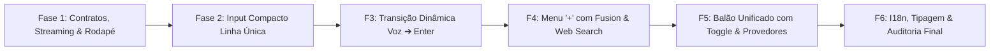

# 🚀 06 - Roadmap Operacional & Checklist de Subtarefas (Revisado)
**Multi+ (NexusLocal) — Plano de Execução Fatiado com Validações Técnicas**

Este documento detalha o plano de implementação sequencial em **6 Fases Granulares**, estruturadas para garantir execução segura, sem regressões de código, respeitando os contratos reais do Multi+ e a avaliação do Impeccable.

> [!IMPORTANT]
> **Aviso de Execução:** Nenhuma tarefa deste roadmap deve ser iniciada sem o aval prévio do usuário. Este documento serve como o roteiro mestre de execução.

---

## 🗺️ Visão Geral das Fases

---

## 📋 Detalhamento das Fases e Subtarefas

### 🔹 Fase 1: Contratos de Cancelamento, Rodapé e Espaçamentos
*Objetivo: Estabelecer os contratos reais de parada de stream, criar o rodapé externo e a nova ancoragem do seletor de modelos.*

- [x] **Subtarefa 1.1 [Contrato P1]:** Implementar `stopStream` em `useChat.ts` (resetando `isStreaming` e limpando buffer), expô-lo via `ChatContext.tsx`, consumi-lo em `ChatWindow.tsx` e passar como prop `onStop?: () => void` em `MessageInput.tsx`, garantindo que o botão `Square` realmente interrompa a geração no cliente.
- [x] **Subtarefa 1.2:** Criar o contêiner `.input-footer-row` em `MessageInput.tsx`, posicionando a mensagem de disclaimer (`t('chat.inputHint')`) à esquerda.
- [x] **Subtarefa 1.3:** Migrar a ancoragem do `ModelSelector` para a extremidade direita do `.input-footer-row` quando em modo de conversa ativa.
- [x] **Subtarefa 1.4:** Ajustar responsividade do rodapé para telas estreitas (< 500px), garantindo legibilidade e ausência de overflow horizontal.
- [x] **Critério de Aceite da Fase 1:** O modelo aparece alinhado à direita na mesma linha do texto de aviso; o botão Parar interrompe o stream com sucesso.

---

### 🔹 Fase 2: Input Compacto de Linha Única para Conversa Ativa
*Objetivo: Fazer com que o campo de digitação assuma a altura esguia de 44px durante conversas em andamento sem desestruturar anexos.*

- [x] **Subtarefa 2.1 [Layout P1]:** Criar a linha interna unificada `.composer-single-line-row` dentro de `.input-card.compact-mode`, mantendo os chips de `AttachmentChip` empilhados acima.
- [x] **Subtarefa 2.2:** Ajustar o `textarea` para operar com `rows={1}`, altura mínima de `24px`, linha de `22px` e auto-expansão até o teto unificado de **`200px`**.
- [x] **Subtarefa 2.3:** Preservar a mesma instância de textarea durante a transição inicial ➔ ativa para evitar perda de rascunho, seleção ou foco.
- [x] **Subtarefa 2.4:** Configurar alvos de toque móveis (`touch-target` de 44px) nos botões sem inflar a barra desktop.
- [x] **Critério de Aceite da Fase 2:** O input ocupa exatamente 1 linha por padrão nas conversas ativas, preserva anexos empilhados e expande suavemente até 200px.

---

### 🔹 Fase 3: Transição Dinâmica de Ações (Voz ➔ Enter Opção A)
*Objetivo: Alternar entre ícones de voz e botão Enter, mantendo controles de voz acessíveis durante a fala.*

- [x] **Subtarefa 3.1 [Máquina de Estados P2]:** Implementar a lógica de estados:
  - Se `isStreaming`: exibe `Square` (Parar).
  - Se `talk.phase === 'listening'`: exibe controles de voz ativos (mesmo com texto preliminar no campo).
  - Se `!hasContent`: exibe `Mic` e `AudioLines`.
  - Se `hasContent`: exibe o botão `↵ Enter` (Opção A).
- [x] **Subtarefa 3.2:** Desenvolver o botão `.btn-send-enter` com o glifo/ícone `↵` (Enter) estilizado.
- [x] **Subtarefa 3.3:** Aplicar micro-animação CSS de fade/scale suave (`actionSwapFadeIn`) de 160ms na alternância.
- [x] **Critério de Aceite da Fase 3:** Digitação substitui os ícones de voz pelo botão Enter; a escuta ativa de voz não perde o botão de encerrar.

---

### 🔹 Fase 4: Menu Integrado `+` com Modo Fusion e Busca Web
*Objetivo: Unificar as ferramentas existentes (Anexos, Prompt Enhancer, Busca Web e Fusion) em um ponto focal único.*

- [x] **Subtarefa 4.1:** Desenvolver o botão circular `+` à esquerda do input (sem pontos luminosos ou badges externos).
- [x] **Subtarefa 4.2:** Construir o popover suspenso com as capacidades reais do Multi+:
  - *Adicionar arquivos ou fotos* (integração direta com o file picker nativo, sem o atalho conflitante Ctrl+U).
  - *Melhorar prompt atual* (`api.enhancePrompt`, desabilitado quando campo vazio).
  - *Busca na web* (toggle com checkmark `✓` indicando status ligado).
  - *Modo Fusion* (com toggle switch idêntico ao benchmark de conectores do Claude em `trogle-conectores.jpg`).
- [x] **Subtarefa 4.3:** No mobile (< 768px), renderizar as opções em `BottomSheet` nativo com alvos de toque de 48px.
- [x] **Subtarefa 4.4:** Remover o botão isolado de `Fusion` do cabeçalho superior (`ChatWindow.tsx`), despoluindo o header.
- [x] **Critério de Aceite da Fase 4:** Todas as ferramentas reais funcionam perfeitamente através do menu `+`.

---

### 🔹 Fase 5: Balão Unificado de Modelos & Provedores (com Toggle)
*Objetivo: Criar o cockpit de seleção de IA com toggle de Smart Router e filtro por provedor, desacoplando navegação e seleção.*

- [x] **Subtarefa 5.1 [Desacoplamento P1]:** Criar estado local `providerFilter` (apenas filtra a listagem; não altera a seleção persistida de modelo até o clique).
- [x] **Subtarefa 5.2 [Restauração P1]:** Implementar o **Toggle Switch de Auto-Roteamento Inteligente**:
  - Quando ativado: armazena `(lastManualModelId, lastManualProviderId)` e ativa `selectModel('auto', 'auto')`.
  - Quando desativado: restaura automaticamente `(lastManualModelId, lastManualProviderId)`.
- [x] **Subtarefa 5.3:** Implementar a barra de pílulas horizontais de provedores (`Todos`, `OpenRouter`, `Anthropic`, `OpenAI`, `Groq`, etc.).
- [x] **Subtarefa 5.4:** Renderizar a lista com dados reais do catálogo (nome, provedor, contexto, score NexusLocal e status de cota).
- [x] **Subtarefa 5.5:** Remover o `ProviderSelector` do cabeçalho de `ChatWindow.tsx` (preservando o componente intacto para a tela de Projetos).
- [x] **Critério de Aceite da Fase 5:** O header fica limpo, o popover abre a partir do rodapé com o toggle de Smart Router e filtro de provedores, sem perder a escolha manual anterior.

---

### 🔹 Fase 6: I18n Rigoroso, Tipagem TypeScript & Matriz de Aceite
*Objetivo: Assegurar estabilidade total, ausência de regressões e tradução completa.*

- [x] **Subtarefa 6.1:** Cadastrar todas as novas strings de tradução nos idiomas oficiais prioritários (`pt-BR.json`, `en-US.json`, `es-ES.json`), com fallback seguro em inglês para as demais localidades do app.
- [x] **Subtarefa 6.2:** Executar a compilação estrita TypeScript (`npm run build` na pasta `frontend`) garantindo 0 erros.
- [x] **Subtarefa 6.3:** Validar matriz de testes: telas de 320px, 375px, 768px e desktop; temas Claro e Escuro; acessibilidade de teclado (`Escape` para fechar menus).
- [x] **Critério de Aceite da Fase 6:** Build 100% verde, i18n completo e experiência de usuário de nível internacional.

---

## 🛡️ Diretrizes de Segurança e Retrocompatibilidade
1. **Zero Locks no Banco:** Nenhuma alteração no banco de dados SQLite `nexuslocal.db`. Todas as mudanças ocorrem exclusivamente no frontend.
2. **Retrocompatibilidade de Componentes:** O `ProviderSelector` e `ModelSelector` originais continuam funcionando normalmente na tela de Projetos (`ProjectsPanel.tsx`).
